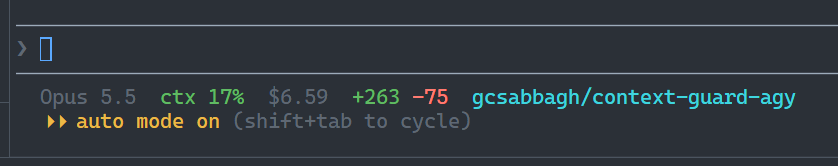

# context-guard

Shows context usage in the statusline. When context passes 50%, Claude is asked to suggest `/compact` at the next task boundary, with instruction text that keeps what the next step needs.

## What you get

Statusline:



It shows the model, context % (green under 50, yellow under 80, red at 80 and above), session cost, lines added and removed, and the git branch.

Prompt hook: at 50% or more, when Claude finishes a turn that closes a task (PR opened, fix confirmed, plan agreed), it ends with a line like:

```
/compact keep: PR #42 and its review comments, the two files changed in src/parser/, the decision to drop the legacy flag
```

Claude doesn't suggest it in the middle of debugging. Above 80% it also tells you to have it write the current state to a file first.

## Install

```
/plugin marketplace add gcsabbagh/agent-plugins
/plugin install context-guard@gcsabbagh-agent-plugins
/context-guard:install
```

Then restart Claude Code.

If you don't want the statusline, run `/context-guard:install --quiet` instead. Your current statusline stays as it is (or stays empty), and only the `/compact` nudge is active.

You need the last command because plugins can't set `statusLine`. The install script copies the statusline script to `~/.claude/context-guard/statusline.sh` and points `~/.claude/settings.json` at it. If you already had a `statusLine` command, it's saved to `~/.claude/context-guard/prev-statusline.sh` and keeps running. Its output is shown in quiet mode and dropped otherwise. The script also backs up `settings.json` to `settings.json.bak-context-guard`, next to the original. The backup is made on the first run only.

### agy (Antigravity CLI)

The same scripts also work in agy. There are two ways to install it. Either way, restart agy afterwards. `--quiet` works the same as for Claude Code. In quiet mode, agy's own status line stays visible (`stack_with_default`).

The commands below are for bash (macOS, Linux, Git Bash). From PowerShell, on any OS, use `install.ps1` instead of `bash install.sh`, with the same arguments. On Windows, `bash` in PowerShell is usually WSL's, which would install into WSL. When `install.sh` notices this, it hands off to `install.ps1`, which finds Git Bash for you:

```powershell
plugins/context-guard/scripts/install.ps1 --agy
```

**Script (one step).** From Claude Code, run `/context-guard:install --agy`. Or, from a clone of this repo:

```
bash plugins/context-guard/scripts/install.sh --agy
```

This copies the scripts to `~/.gemini/context-guard/`, points `statusLine` in `~/.gemini/antigravity-cli/settings.json` at the statusline, and adds a `context-guard` `PreInvocation` hook to `~/.gemini/config/hooks.json`. Other hooks in that file, such as Orca's, are left alone. Both files are backed up once to `*.bak-context-guard`. After updating, run it again to copy the new scripts.

**agy plugin.** The plugin folder is also a native agy plugin (`.antigravity-plugin/plugin.json` and a root `hooks.json`, which Claude Code ignores). It brings the hook, which you can turn on and off from `/plugin` in agy. agy plugins can't set a status line, though, and the hook reads the context % that the status line records. So run the installer once from the installed plugin:

```
agy plugin install plugins/context-guard
bash ~/.gemini/config/plugins/context-guard/scripts/install.sh --agy
```

(From PowerShell, the second line is `~/.gemini/config/plugins/context-guard/scripts/install.ps1 --agy`.)

When the plugin is installed, the installer points the status line at the plugin's copy of the scripts and skips registering its own hook. If one is left from a script install, it removes it, so you don't get two nudges. Settings and state stay in `~/.gemini/context-guard/`. To update, re-run `agy plugin install` (it replaces the old copy). The status line picks up the new scripts with no further step.

What's different from Claude Code:

- The statusline has no cost or lines-changed segments, since agy doesn't report them.
- The nudge line is phrased for agy's `/compact <message>`, which summarizes and then answers the message, as `/compact Next: <the next step>. Keep in mind: <...>`.
- On Windows, agy runs commands through `cmd /c`, where `bash` is usually WSL's and quoted paths get mangled. Both routes therefore go through `scripts/agy.cmd`, which finds Git Bash itself (see [Requirements](#requirements)). The path to the scripts can't contain spaces. The plugin's hook command is `scripts\agy.cmd … || bash scripts/prompt-hook.sh …`: `cmd` runs the first half, and `sh` on macOS/Linux falls through to the second.

## Requirements

All platforms:

- `bash` 3.2 or later. The one macOS ships is fine.
- `jq` on your PATH (`brew install jq`, `apt install jq`, or `winget install jqlang.jq` on Windows). It has to be on the PATH that Claude Code or agy runs commands with, not just in your shell profile. On Windows that means the Windows PATH; winget sets it.
- `git`, optional: only used for the branch segment.

Windows:

- [Git for Windows](https://git-scm.com/download/win) (`winget install Git.Git`). Git Bash runs the scripts. Claude Code already requires it on Windows. For agy, `agy.cmd` and `install.ps1` look for it in this order:
  1. `CONTEXT_GUARD_BASH`, if set (see [Configuration](#configuration)).
  2. `%ProgramFiles%\Git\bin\bash.exe`.
  3. `..\bin\bash.exe` next to the `git` on PATH (`...\Git\cmd\git.exe`), which covers user-scope installs.

  Installs where that layout doesn't hold, such as Scoop's shim, need `CONTEXT_GUARD_BASH`. If no Git Bash is found, agy shows no context-guard statusline, the hook does nothing, and agy carries on.
- Run `install.sh` from Git Bash, or use `install.ps1` from PowerShell (Windows PowerShell 5.1 or PowerShell 7). WSL isn't needed. If `install.sh` is run with WSL's bash, it runs `install.ps1` through `powershell.exe` instead, so it installs into Windows. It stops if the repo isn't on a Windows drive.
- For agy: no spaces in your user profile path (e.g. `C:\Users\John Smith`). agy can't run a command whose path has one, so the installer refuses. Claude Code isn't affected.
- If PowerShell blocks the script, run `powershell -ExecutionPolicy Bypass -File plugins/context-guard/scripts/install.ps1 ...`.

Apps:

- Claude Code with `statusLine` and `UserPromptSubmit` hook support.
- agy 1.5.5 or later (the version tested). It needs `context_window.used_percentage` in the status line JSON and `PreInvocation` hooks with `invocationNum` and `injectSteps`.

Tests: Node 22 or later, plus the above.

## Configuration

`/context-guard:install --quiet`: no visible statusline, nudge only. Run `/context-guard:install` again to switch back.

`CONTEXT_GUARD_THRESHOLD` (default `50`): the context % at which the prompt hook starts nudging. Set it in the `env` block of `~/.claude/settings.json`. For agy, set it as an environment variable in the shell you start agy from.

`CONTEXT_GUARD_BASH` (Windows, agy only): full path to the Git Bash `bash.exe` to use, when it isn't found automatically, e.g. with Scoop. agy reads it from the environment it starts in, so make it a user environment variable (`setx CONTEXT_GUARD_BASH "C:\path\to\Git\bin\bash.exe"`) and open a new terminal. `install.ps1` honors it too.

## How it works

Only the statusline receives live context metrics, so the statusline script writes the current % to `${TMPDIR:-/tmp}/claude-ctx-<session_id>`. The `UserPromptSubmit` hook reads that file. When the % is at or above the threshold, it injects a short instruction as `additionalContext`.

In agy, the statusline JSON has the same shape, so the statusline script is shared as is. The hook runs as `PreInvocation` with `--agy`. agy calls it before every model call, so it only injects on the first call of a turn (`invocationNum` 0), as a `systemMessage` in `injectSteps`. It reads the session from `conversationId`, which matches the statusline's `session_id`.

## Uninstall

```
/plugin uninstall context-guard@gcsabbagh-agent-plugins
```

Then restore `statusLine` in `~/.claude/settings.json` from `settings.json.bak-context-guard`, or delete the key.

For agy: delete `statusLine` from `~/.gemini/antigravity-cli/settings.json` (or restore it from the backup), delete the `context-guard` key from `~/.gemini/config/hooks.json` (or run `agy plugin uninstall context-guard` if you used the plugin), and remove `~/.gemini/context-guard/`.

## Tests

```
npm test
```

`test/context-guard.test.mjs` runs the statusline, the prompt hook and the installer for Claude Code and both agy routes. Each case uses a temporary home folder, so your real config isn't touched. On Windows it also runs the `.cmd` launchers and the plugin's hook command through `cmd` the way agy does, and checks that the installer hands off from WSL's bash to `install.ps1` (or stops when it can't). `install.ps1` is tested under every PowerShell found (Windows PowerShell 5.1, PowerShell 7). It needs `jq` and, on Windows, Git Bash. Cases that need agy, WSL or PowerShell are skipped when those aren't installed.
