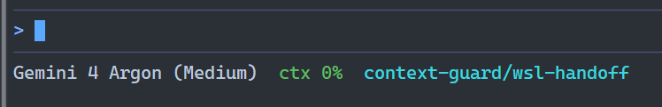

# context-guard

A status line and a `/compact` nudge for coding agents. The status line shows how full the context window is. Once context passes 50%, the agent is asked to suggest `/compact` at the next task boundary, with instruction text that keeps what the next step needs.

Supported agents: [agy (Antigravity CLI)](#agy) and [Claude Code](#claude-code). All agents run the same scripts, and agent differences sit behind installer flags. More agents can be added; see [Adding an agent](#adding-an-agent).

## What you get

**Status line.** The model, context % and git branch. The context % is green below the nudge threshold (50 by default), yellow from the threshold, when the nudge is on, and red at 80 and above, when the nudge also asks to save state first. Session cost and lines added and removed are shown when the agent reports them.

agy:



Claude Code:


**Nudge.** At 50% or more, when the agent finishes a turn that closes a task (PR opened, fix confirmed, plan agreed), it ends its reply with a `/compact` line you can copy. It doesn't suggest one in the middle of debugging. Above 80% it also tells you to have it write the current state to a file first. The line follows each agent's `/compact` syntax:

| Agent | Nudge line |
|---|---|
| agy | `/compact Next: run the parser tests. Keep in mind: PR #42 and its review comments, the decision to drop the legacy flag` |
| Claude Code | `/compact keep: PR #42 and its review comments, the two files changed in src/parser/, the decision to drop the legacy flag` |

agy's `/compact <message>` summarizes and then answers the message, so its line leads with the next step.

### Agents at a glance

| | agy | Claude Code |
|---|---|---|
| Status line segments | model, context %, branch | model, context %, cost, lines changed, branch |
| Nudge hook | `PreInvocation`, first model call of each turn | `UserPromptSubmit` |
| Where the hook comes from | the agy plugin, or the installer | the Claude Code plugin |
| Installer flag | `--agy` | `--claude` |
| Config folder | `~/.gemini/` | `~/.claude/` |

## Install

Plugins can't set an agent's status line, so every install includes one installer step, `scripts/install.sh`. The sections per agent below give the exact commands.

### The installer

```
bash plugins/context-guard/scripts/install.sh --agy|--claude [--nudge-only]
```

- **Agent:** `--agy` or `--claude`. With no agent flag it installs for Claude Code, because `/context-guard:install` inside Claude Code relies on that.
- **`--nudge-only`:** the `/compact` nudge without context-guard's status line. The status line script still runs, because it records the context % the nudge needs, but it prints only a status line you already had, or nothing. In agy, its own default line stays visible (`stack_with_default`). Run the installer again without `--nudge-only` to switch back.
- **PowerShell, any OS:** use `install.ps1` with the same arguments, e.g. `plugins/context-guard/scripts/install.ps1 --agy`. On Windows, `bash` in PowerShell is usually WSL's, which would install into WSL. When `install.sh` notices this, it hands off to `install.ps1`, which finds Git Bash for you.
- **Existing status line:** a `statusLine` command you already had is saved as `prev-statusline.sh` in the agent's context-guard folder and keeps running. Its output is shown in nudge-only mode and dropped otherwise.
- **Backups:** each config file the installer edits is backed up once, on the first run, to `<file>.bak-context-guard` next to the original.
- **Re-running** is safe and is how you switch modes. Script installs also need a re-run after updating, to copy the new scripts.

### agy

There are two routes. Either way, restart agy afterwards.

**Script (one step).** From a clone of this repo:

```
bash plugins/context-guard/scripts/install.sh --agy
```

Or, from inside Claude Code with the plugin installed, `/context-guard:install --agy`.

This copies the scripts to `~/.gemini/context-guard/`, points `statusLine` in `~/.gemini/antigravity-cli/settings.json` at the status line, and adds a `context-guard` `PreInvocation` hook to `~/.gemini/config/hooks.json`. Other hooks in that file, such as Orca's, are left alone.

**agy plugin.** The plugin folder is also a native agy plugin (`.antigravity-plugin/plugin.json` and a root `hooks.json`). It brings the hook, which you can turn on and off from `/plugin` in agy. agy plugins can't set a status line, though, and the hook reads the context % that the status line records. So run the installer once from the installed plugin:

```
agy plugin install plugins/context-guard
bash ~/.gemini/config/plugins/context-guard/scripts/install.sh --agy
```

(From PowerShell, the second line is `~/.gemini/config/plugins/context-guard/scripts/install.ps1 --agy`.)

When the plugin is installed, the installer points the status line at the plugin's copy of the scripts and skips registering its own hook. If one is left from a script install, it removes it, so you don't get two nudges. Settings and state stay in `~/.gemini/context-guard/`. To update, re-run `agy plugin install` (it replaces the old copy). The status line picks up the new scripts with no further step.

On Windows, agy runs commands through `cmd /c`, where `bash` is usually WSL's and quoted paths get mangled. Both routes therefore go through `scripts/agy.cmd`, which finds Git Bash itself (see [Requirements](#requirements)). The path to the scripts can't contain spaces. The plugin's hook command is `scripts\agy.cmd … || bash scripts/prompt-hook.sh …`: `cmd` runs the first half, and `sh` on macOS/Linux falls through to the second.

### Claude Code

```
/plugin marketplace add gcsabbagh/agent-plugins
/plugin install context-guard@gcsabbagh-agent-plugins
/context-guard:install
```

Then restart Claude Code. Pass `--nudge-only` to `/context-guard:install` the same way as to the installer.

`/context-guard:install` runs the installer for Claude Code. It copies the status line script to `~/.claude/context-guard/statusline.sh` and points `statusLine` in `~/.claude/settings.json` at it. The nudge hook comes with the plugin. Without the plugin, `bash plugins/context-guard/scripts/install.sh --claude` sets up the status line only.

## Requirements

All platforms:

- `bash` 3.2 or later. The one macOS ships is fine.
- `jq` on your PATH (`brew install jq`, `apt install jq`, or `winget install jqlang.jq` on Windows). It has to be on the PATH the agent runs commands with, not just in your shell profile. On Windows that means the Windows PATH; winget sets it.
- `git`, optional: only used for the branch segment.

Agents:

- **agy** 1.5.5 or later (the version tested). It needs `context_window.used_percentage` in the status line JSON and `PreInvocation` hooks with `invocationNum` and `injectSteps`.
- **Claude Code** with `statusLine` and `UserPromptSubmit` hook support.

Windows:

- [Git for Windows](https://git-scm.com/download/win) (`winget install Git.Git`). Git Bash runs the scripts. WSL isn't needed.
- Run `install.sh` from Git Bash, or `install.ps1` from PowerShell (Windows PowerShell 5.1 or PowerShell 7). If `install.sh` is run with WSL's bash, it runs `install.ps1` through `powershell.exe` instead, so it installs into Windows. It stops if the repo isn't on a Windows drive.
- If PowerShell blocks the script, run `powershell -ExecutionPolicy Bypass -File plugins/context-guard/scripts/install.ps1 ...`.
- **agy:** `agy.cmd` and `install.ps1` look for Git Bash in this order:
  1. `CONTEXT_GUARD_BASH`, if set (see [Configuration](#configuration)).
  2. `%ProgramFiles%\Git\bin\bash.exe`.
  3. `..\bin\bash.exe` next to the `git` on PATH (`...\Git\cmd\git.exe`), which covers user-scope installs.

  Installs where that layout doesn't hold, such as Scoop's shim, need `CONTEXT_GUARD_BASH`. If no Git Bash is found, agy shows no context-guard status line, the hook does nothing, and agy carries on.
- **agy:** no spaces in your user profile path (e.g. `C:\Users\John Smith`). agy can't run a command whose path has one, so the installer refuses.
- **Claude Code** already requires Git for Windows, and finds its bash itself.

Tests: Node 22 or later, plus the above.

## Configuration

**Nudge only:** see `--nudge-only` in [The installer](#the-installer).

**`CONTEXT_GUARD_THRESHOLD`** (default `50`): the context % at which the nudge starts and the status line turns yellow. Red stays at 80. Set it where the agent reads its environment:

- **agy:** an environment variable in the shell you start agy from.
- **Claude Code:** the `env` block of `~/.claude/settings.json`.

**`CONTEXT_GUARD_BASH`** (Windows, agy only): full path to the Git Bash `bash.exe` to use, when it isn't found automatically, e.g. with Scoop. agy reads it from the environment it starts in, so make it a user environment variable (`setx CONTEXT_GUARD_BASH "C:\path\to\Git\bin\bash.exe"`) and open a new terminal. `install.ps1` honors it too.

## How it works

Only the status line receives live context metrics. So `statusline.sh` writes the current % to `${TMPDIR:-/tmp}/claude-ctx-<session_id>`, and `prompt-hook.sh` reads that file when the agent's prompt hook runs. When the % is at or above the threshold, it injects a short instruction. Both scripts are shared, and flags select each agent's input keys, wording and output format:

- **agy:** the status line JSON uses the same fields, so `statusline.sh` runs as is. The hook runs as `PreInvocation` with `--agy`. agy calls it before every model call, so it only injects on the first call of a turn (`invocationNum` 0), as a `systemMessage` in `injectSteps`. It reads the session from `conversationId`, which matches the status line's `session_id`.
- **Claude Code:** the hook runs as `UserPromptSubmit` and injects the instruction as `additionalContext`.

## Uninstall

### agy

Delete `statusLine` from `~/.gemini/antigravity-cli/settings.json`, or restore it from the backup. Delete the `context-guard` key from `~/.gemini/config/hooks.json`, or run `agy plugin uninstall context-guard` if you used the plugin. Then remove `~/.gemini/context-guard/`.

### Claude Code

```
/plugin uninstall context-guard@gcsabbagh-agent-plugins
```

Then restore `statusLine` in `~/.claude/settings.json` from `settings.json.bak-context-guard`, or delete the key, and remove `~/.claude/context-guard/`.

## Adding an agent

An agent can be supported if it:

- runs a status line command and passes it the context % used, and
- has a hook that runs before the model handles a prompt and can add text to it.

To add one:

- **`install.sh`:** add a `--<agent>` flag that sets the agent's config paths and writes its settings format.
- **`prompt-hook.sh`:** add a flag for the agent's hook input keys, output format and `/compact` syntax.
- **`statusline.sh`:** change it only if the agent's status line JSON uses other field names.
- **Manifest:** add one if the agent has a plugin format, and add it to the test that keeps the manifests' name, version and description in sync.
- **Tests and docs:** add tests in `test/context-guard.test.mjs`, a column in the tables above, and a column in the [repo README](../../README.md).

## Tests

```
npm test
```

`test/context-guard.test.mjs` runs the status line, the prompt hook and the installer for every supported agent, including both agy routes. Each case uses a temporary home folder, so your real config isn't touched. On Windows it also runs the `.cmd` launchers and the plugin's hook command through `cmd` the way agy does, and checks that the installer hands off from WSL's bash to `install.ps1` (or stops when it can't). `install.ps1` is tested under every PowerShell found (Windows PowerShell 5.1, PowerShell 7). It needs `jq` and, on Windows, Git Bash. Cases that need agy, WSL or PowerShell are skipped when those aren't installed.
